# Phosphor

Phosphor shows Star Citizen data on WINWING MFD screens, or on any spare monitors, next to the game. It is read-only and sends nothing to the game.

**Status: in development. There is no download yet.** More at <https://phosphormfd.com>.

Phosphor is an unofficial, fan-made program. It is not affiliated with, endorsed by, or supported by the Cloud Imperium group of companies.

## What the screens will look like

<p align="center">
  
</p>

This is a mock-up with sample data. It is not a screenshot, because the program does not draw its pages yet. The picture cycles through six of the planned pages, four seconds each, like the screen at the top of the website. All nineteen mock-ups are in [`mockup-images/`](mockup-images/README.md), with notes on what each one shows.

## Building it

You need a Java 25 JDK. The Gradle wrapper downloads the right Gradle version on its own.

```
./gradlew build
```

On Windows, use `gradlew.bat` instead of `./gradlew`.

`build` compiles the program and runs the tests.

To run it, pass a config file. The example in `run/` works as is:

```
./gradlew run --args="--config run/config.example.yaml"
```

For now that only loads and validates the config, logs one line with what it found, and exits, because the program cannot open the MFD screens yet. The config keys are documented in `run/config.example.yaml`.

To see the pages in ordinary desktop windows, add `--windowed`:

```
./gradlew run --args="--config run/config.example.yaml --windowed"
```

Only the Waiting page and a debug page are drawn so far. Close any window to quit.

Use `--demo` in place of `--windowed` to feed the pages made-up data, so they can be worked on without the game. The data runs for eight seconds, stops for five, and repeats.

## License

I have not picked a license yet. Until I do, default copyright applies, which means nobody else may reproduce, distribute, or create derivative works from this code.
