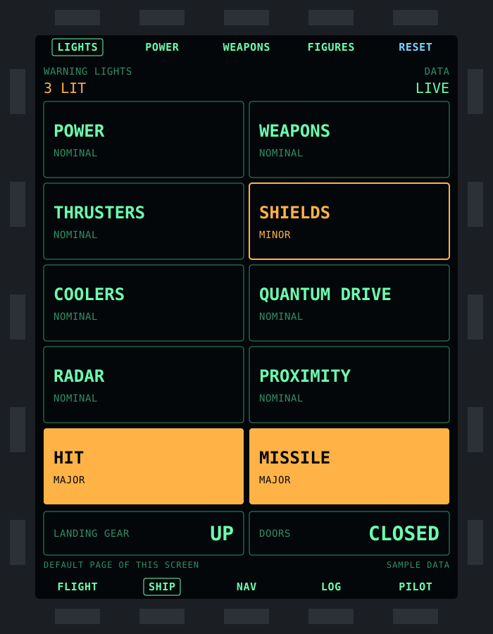
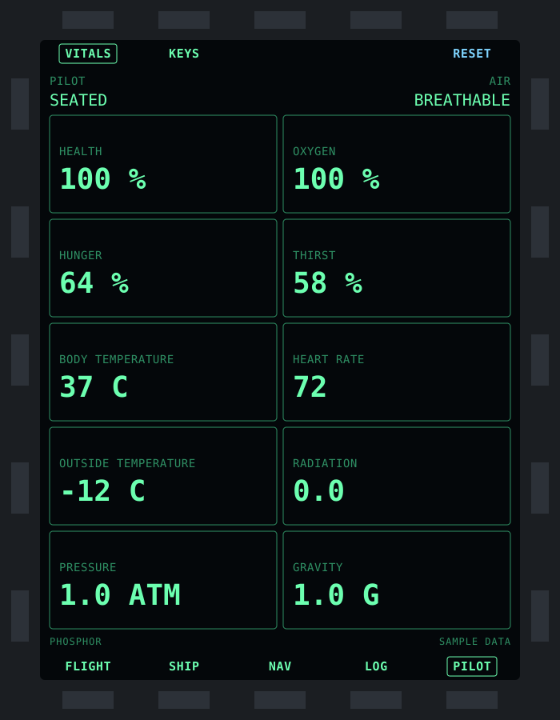

# Phosphor mock-ups

Hand-drawn SVG mock-ups of the pages I have planned for Phosphor, filled with sample data. The program does not draw any of them yet.

## The three default pages

| Left MFD | Center MFD | Right MFD |
| --- | --- | --- |
|  |  |  |

## The tour

`tour.svg` is the animated picture at the top of the repository's README. It is one screen that pages through six of the mock-ups, four seconds each, in the same order as the screen at the top of the website: FLIGHT / MAIN, SHIP / LIGHTS, PILOT / VITALS, SHIP / FIGURES, FLIGHT / MODES, SHIP / POWER. With reduced motion turned on, it stays on the first page.

`BuildTour.java` builds it. The tool copies the six pictures into one file as layers and adds the CSS that shows one layer at a time. Do not edit `tour.svg` by hand. When one of the six pictures changes, rebuild it from the repository's folder and commit the result:

```
java mockup-images/BuildTour.java
```

It needs Java 25, like the program, and it overwrites `mockup-images/tour.svg`. `TOUR` and `SECONDS_PER_PAGE` at the top of `BuildTour.java` control which pages are shown, their order, and how long each one stays.

## The pictures

Nineteen SVG files, one per screen. Each is 700 by 900 and shows the 600 by 800 screen inside the MFD frame, with the bezel buttons drawn as plain gray bars. Any browser opens them. The Build column is the Phosphor build a page belongs to.

| File | Screen | Reads from | Build |
| --- | --- | --- | --- |
| `lights-page.svg` | SHIP / LIGHTS, default of the left MFD | the stream | 1.1 |
| `flight-page.svg` | FLIGHT / MAIN, default of the center MFD | the stream | 1.1 |
| `figures-page.svg` | SHIP / FIGURES | the ship database | 2.0 |
| `waiting-page.svg` | the Waiting page | nothing | 1.1 |
| `first-start.svg` | First start: a screen with no default page yet | nothing | 2.0 |
| `picker-maker.svg` | Ship picker, step 1: choose a maker | the ship database | 2.0 |
| `picker-ship.svg` | Ship picker, step 2: choose a ship | the ship database | 2.0 |
| `modes-page.svg` | FLIGHT / MODES | the stream | 2.0 |
| `power-page.svg` | SHIP / POWER | the stream | 2.0 |
| `weapons-page.svg` | SHIP / WEAPONS | the stream | 2.0 |
| `vitals-page.svg` | PILOT / VITALS, default of the right MFD | the stream | 1.1 |
| `session-page.svg` | NAV / SESSION | the log, plus wallet and health from the stream | 2.0 |
| `events-page.svg` | LOG / EVENTS | the log | 2.0 |
| `here-page.svg` | NAV / HERE | the trade database | 3.0 |
| `server-page.svg` | NAV / SERVER | the log | 3.0 |
| `contract-page.svg` | LOG / CONTRACT | the log | 3.0 |
| `economy-page.svg` | LOG / ECONOMY | the trade database and the log | 3.0 |
| `refinery-page.svg` | LOG / REFINERY | the log | 3.0 |
| `keys-page.svg` | PILOT / KEYS | the player's key bindings file | 3.0 |

Each picture shows its page in one state. The stream is live, three warning lights are lit on LIGHTS, the ship is found on FIGURES, and the Waiting page says the game is not running.

## Not redrawn yet

- No picture shows the final footer, which is `DEFAULT · PHOSPHOR <build>` on a screen's default page and `PHOSPHOR <build>` on every other page.
- `lights-page.svg` and `flight-page.svg` still say "DEFAULT PAGE OF THIS SCREEN".
- `vitals-page.svg` is drawn as a non-default page and has no data status in its header.
- The stale and no-data states are not drawn.

## How to read a page

- **Bottom row of labels:** the five groups (FLIGHT, SHIP, NAV, LOG, PILOT), the same on every page.
- **Top row of labels:** the pages in the current group, up to four.
- **Boxed label:** the group and page being shown.
- **RESET** (top right, light blue): press to return to the screen's default page, hold to make the current page the default.
- **Side buttons:** unused except in the ship picker, where each one picks the name next to it.
- **Center:** the data, at full width.
- **Footer:** the small dim-green line at the bottom left, above the group labels. `<build>` stands for the program's build.

## What is sample and what is design

- **Sample:** every number. Text in square brackets (`[SHIP NAME]`, `[PLACE NAME]`, `[PROVIDER]`) stands for text the game or a data provider supplies. "SAMPLE DATA" on the right of the footer line is the mock-up's own label and is not part of the program.
- **Ship outline:** the outline on FIGURES is a stand-in I drew and is not a real ship. The real page would show the ship's actual top view. That is CIG's artwork, so it is not copied here.
- **Units:** the pictures show metric values. Every measurement follows a metric / imperial / aviation setting, temperatures included (VITALS shows them here as `C`). The setting changes the numbers and their unit labels, and the layout stays the same.
- **Design:** the layout, sizes, labels, colors, typeface, groups, and which page sits under which button.
- **Not confirmed yet:** which values the game really provides. The stream pages (LIGHTS, FLIGHT, MODES, POWER, WEAPONS, VITALS) show what the stream is defined to carry, and the log pages show what community tools say the log carries. Captures from the game will decide what each page can really show.

## Colors

| Color | Value | Means |
| --- | --- | --- |
| Black ground | `#04070A` | the screen |
| Bright green, bold | `#6CFFB0` | values |
| Dim green | `#2E8F63` | labels and outlines |
| Orange | `#FFB347` | needs attention: a lit warning light (outlined for minor, filled for major), money going out, data that could not be found |
| Compass orange | `#FF8C1A` | the compass ring, tick marks, and arrow on FLIGHT / MAIN |
| Amber-brown | `#B8853A` | stale values |
| Light blue | `#7FD4FF` | RESET, and MINE in the ship picker |
| Frame | `#1B1E22`, buttons `#2C3138` | the MFD around the screen, which the program does not draw |

## Typeface

B612 Mono. The pictures name the font but do not embed it. If it is not installed, the browser falls back to DejaVu Sans Mono or another monospace font, and the text comes out slightly wider or narrower than intended.
